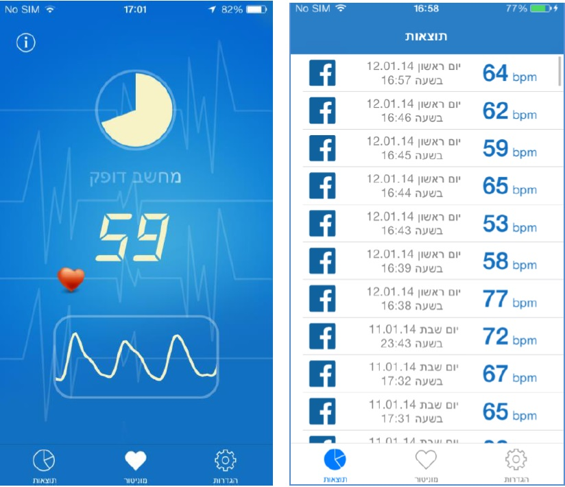

# HeartBeat for iOS

<p align="center">
  
</p>


HeartBeat was developed to estimate pulse rate from color changes in a fingertip illuminated by an iPhone camera flash. The historical app averages the green channel, filters the resulting time series and tracks peaks. This repository preserves the iOS source and report and provides a separately maintained Python translation of the signal-processing core.

Students: Or Maayan, Michael Leybovich. Supervision: Aaron Wetzler.

*The historical app screenshots show recorded interface output, not validated measurements from the updated code.*

## What is available

- [Original report](docs/report.pdf) and the students' [mishana/Heartbeat](https://github.com/mishana/Heartbeat) source, pinned as the `source/` Git submodule at `d5179096b96941bc0ff6aa8f0bacd88958dd37dd`.
- [Updated Python core](updated/): BGRA frame averaging, Butterworth filtering and the peak/BPM state machine. It accepts supplied green-component samples or frame buffers; it does not capture camera data.
- A [synthetic-signal notebook](updated/notebooks/heartbeat_port_demo.ipynb) and a macOS reference harness for comparing algorithm traces with the original Objective-C++ code.

## Run the Python component

The port uses Python 3.10+ and the standard library. From a checkout:

```sh
git submodule update --init --recursive
cd updated
python3 demo.py --bpm 84 --seconds 30
python3 -m unittest discover -s tests -v
```

The demo prints time in seconds, estimated beats per minute and calibration/display flags. It can also read one mean-green value on a 0–255 scale per line, sampled at an assumed 30 frames per second. The demo and fixture-based Python tests do not need the submodule; the complete test command attempts a live reference comparison on macOS with Apple clang, which requires it. See the [component guide](updated/README.md) for CSV/SVG output, Jupyter setup, reference comparisons and algorithm details.

## Inspect the original app

Clone with `--recurse-submodules`, then open `source/Heartbeat.xcodeproj` in Xcode. The historical target is iOS 7.0; the report used an iPhone 5. It needs Apple camera/graphics/audio frameworks, Core Plot and a Facebook SDK framework whose developer-relative path is absent. Camera/flash testing requires a physical device and your own signing configuration. This is a restoration starting point, not a verified modern installation procedure.

## Validation and limitations

The [2026-11-12 record](updated/VALIDATION.json) reports 20 component tests and six notebook code cells executed on macOS 15.1.1 arm64 with Python 3.14.4. Tests cover filters, frame reduction, state-machine behavior, saved original traces and a compiler-dependent live comparison. The saved run log records the live comparison as passed among those 20 tests; it skips when macOS/Apple clang is unavailable. With that toolchain present, an uninitialized source submodule causes the live comparison to fail rather than skip. A minimal UIKit shim allows the unchanged original `Algorithm.mm`/`Butterworth.cpp` to run on macOS; this does not build the iOS app.

On the tested synthetic green-component sequences, every recorded per-frame trace field matches the compiled original exactly for both app configurations. The Python reduction uses double precision where the original raw-frame scaling used float32, so raw iPhone frames are not proven bit-identical. The historical iPhone 5 also used 32-bit `CGFloat`; the Mac harness uses 64-bit `CGFloat`. AddressSanitizer confirmed an out-of-bounds original filter loop; the port computes only in-range outputs. Details and comparison limits are in the [algorithm notes](updated/ALGORITHM.md).

The port deliberately retains historical output quirks: a flat signal can produce the 72 bpm placeholder as a final result, and the missed-peak logic consults that placeholder. The original app had a separate finger-presence check that this core does not perform. Synthetic agreement does not measure pulse-rate accuracy. The complete iOS app, device capture and Linux runtime have not been validated. This research software is not a medical device.

## Original code and attribution

The pinned student source and its all-rights-reserved notices are unchanged. The Python translation was drafted with Claude Code, then completed/reviewed/tested with Codex for Aaron Wetzler in 2026. No blanket license is added for original or derived code; third-party terms still apply. Authors can open an issue to contribute changes, correct attribution or request removal.

## Links

- [Project entry on Aaron Wetzler's website](https://twerdster.github.io/#heartbeat-for-ios)
- [Original final report](docs/report.pdf)
- [Original demonstration](https://www.youtube.com/watch?v=dHomdiuAAFw)
