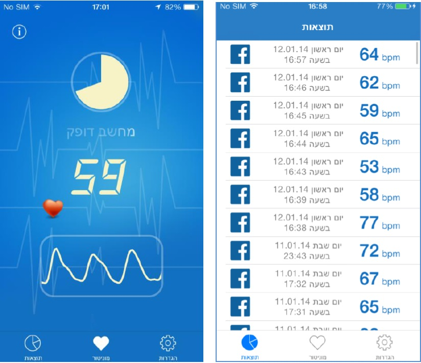

# HeartBeat for iOS

HeartBeat estimated pulse rate from colour changes in a fingertip lit by an iPhone camera flash. Its processing chain averages the green channel, filters the samples and tracks peaks.

Original project: **Or Maayan and Michael Leybovich**. Supervision: **Aaron Wetzler**.

*Historical app screens, not an accuracy result for the updated code.*

The student source is pinned unchanged. Separate Python and C++ processing code repairs a filter bounds error; new Android, iOS, macOS and Linux interfaces replay supplied PPG samples. The historical camera app remains unbuilt.

## Updated

**[Open the browser demo](https://twerdster.github.io/heartbeat-ios/)** · [Updated guide](updated/README.md)

The page replays BIDMC01 pulse-oximeter PPG and saved original-logic/guarded estimates against the dataset’s ECG reference. It does not use a camera or run the estimator. Python/C++ processing and Android, iOS, macOS and Linux replay apps are separate updated components. One record does not establish clinical or camera accuracy.

[Python setup and native replay apps](updated/DETAILS.md) · [Replay controls and data terms](updated/demo/README.md) · [Validation](updated/VALIDATION.json)

## Project record and rights

[Historical context, attribution and recovery details](PROJECT_RECORD.md) preserve the earlier record. Original material, datasets, dependencies and new code keep their separately stated terms; no blanket license is added.
