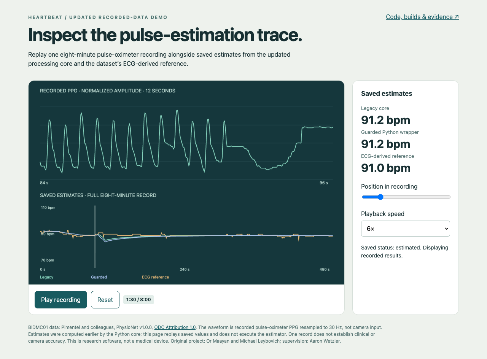

# HeartBeat for iOS: updated work

## Updated work

**[Open the browser demo](https://twerdster.github.io/heartbeat-ios/)**

The **interactive recording replay** shows recorded PPG, saved legacy/guarded estimates and an ECG-derived reference. It replays earlier results rather than executing the estimator in JavaScript. The Python core and native replay apps are described in [the detailed guide](DETAILS.md).

[Browser demo guide](demo/README.md) describes local use, checks and limitations.

[Detailed implementation, setup and recorded results](DETAILS.md).

Historical project: Or Maayan and Michael Leybovich; supervision: Aaron Wetzler. New implementations are labeled separately and do not change the preserved materials.

*Actual Chrome interface capture. Its input and execution scope are described above and in the demo guide.*
