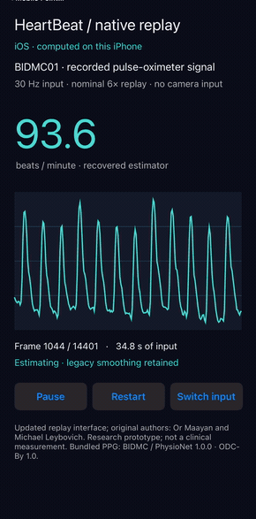

# Heartbeat processing core — updated 2026

| iOS native replay · iPhone 12 | Recorded-input comparison |
| --- | --- |
|  |  |

The new UIKit interface computes estimates from supplied PPG samples on the phone. This is recorded pulse-oximeter input, not camera capture. Screen recordings: [iOS](assets/ios-native.mp4) · [Android](assets/android-native.mp4) · [macOS](assets/macos-native.mp4) · [Linux](assets/linux-native.mp4). [Builds, controls and platform evidence](platforms/NATIVE.md).

The right-hand generated figure compares BIDMC01 pulse-oximeter PPG, legacy/guarded estimates and recorded ECG-derived heart rate. The six-second animation replays a 60-second excerpt at 10×; metrics cover the full eight-minute recording after a ten-second warm-up. [MP4](assets/heartbeat-recording.mp4) · [Full-size plot](assets/heartbeat-recording.png).

This component runs the green-channel filter, peak detection and BPM state machine recovered from Or Maayan and Michael Leybovich’s HeartBeat app, supervised by Aaron Wetzler. It accepts supplied samples; the new replay interfaces are described below. Camera capture, finger detection and Facebook integration remain outside the updated component. The original pinned `../source/` is unchanged.

## What works and what changed

The existing standard-library Python translation remains the legacy mode. A separately repaired C++ filter now bounds its startup and final loops. It is compiled with unchanged `Algorithm.mm` in place of the original filter in a macOS harness with a minimal UIKit shim; the filter alone also builds on Linux. The Butterworth coefficients, local-peak/count/smoothing chain and original 61/46-sample window configurations remain intact.

A new C++ translation also runs through UIKit, Android Canvas/JNI, AppKit and Linux Tk interfaces. It uses the repaired filter and preserves the recovered estimator’s state transitions. The new UI shows the latest BPM after calibration, rather than reproducing the historical stability/display gates. All four completed the 14,401-frame recording; separate macOS and Linux CLI checks compare all 11 trace fields against the earlier faithful Python port. These frontends are updated work, not the historical app UI.

An optional Python `TimestampedHeartbeat` wrapper does not insert inferred missed peaks, requires observed peaks before calibration, withholds constant input and resets after gaps. It resamples supplied timestamps onto the original 30 Hz grid. These are labeled behavioral changes, not recovered app behavior; they do not classify every noisy or finger-free input.

## Run

Python 3.10+ is sufficient for the core and component tests:

```sh
python3 demo.py --bpm 84 --seconds 30
python3 -m unittest discover -s tests -v
```

The demo input is synthetic. `HeartbeatAlgorithm` still exposes historical placeholder/display quirks for comparison. For the guarded API, build commands, real-data replay and notebook, see [the running guide](RUNNING_2026.md). The [algorithm notes](ALGORITHM.md) describe the operator chain and floating-point qualifications.

## Verified results

On 2026-11-14, 25 Python tests passed on macOS; Linux passed 24 with the macOS Foundation comparison explicitly skipped. The repaired C++ filter’s independent recurrence test (seven lengths each, transfer orders 2 and 10) passed with AddressSanitizer/UndefinedBehaviorSanitizer on both systems. On macOS, ASan reproduced the original filter overflow; the repaired build completed the same 90-frame input without an ASan report (no leak check).

The macOS `Algorithm.mm` harness with the repaired filter and legacy Python agree in all 11 trace fields for 14,401 BIDMC01 frames and two 900-frame synthetic configurations. Against 471 ECG-derived HR samples (1 Hz, 10–480 s), legacy mode had MAE 0.76 bpm/RMSE 1.19 bpm; guarded mode had higher error, MAE 0.93 bpm/RMSE 1.50 bpm. Guarded mode returned an estimate at all 471 timestamps; legacy mode does not withhold by design. [Metrics, traces and logs](validation/2026-11-14/).

## Limits and attribution

The attempted Xcode 16.1/iOS 18.1 simulator build (signing disabled, locale C) stopped at missing `FacebookSDK/FacebookSDK.h`; later blockers remain unknown. The new replay interfaces ran on iPhone 12/iOS 18.0.1, Pixel 2/Android 10, Apple Silicon/macOS 15.1.1 and Ubuntu 22.04 with an isolated Xvfb display. Live device/camera acquisition, historical 32-bit arithmetic, clinical accuracy, multi-subject benchmarks and the full historical iOS application remain unvalidated. BIDMC is pulse-oximeter PPG, not camera data; results from one record do not establish general performance. The inherited long-term smoothing can obscure short rate changes.

Claude Code drafted the earlier translation; Codex completed/tested it and prepared the separately labeled 2026-11-14 repairs, guards and replay tooling for maintainer Aaron Wetzler. Original source notices and student credits remain. No blanket code license is added. BIDMC data/figures are attributed to Pimentel and colleagues, PhysioNet v1.0.0, under [ODC Attribution 1.0](https://physionet.org/content/bidmc/1.0.0/).
